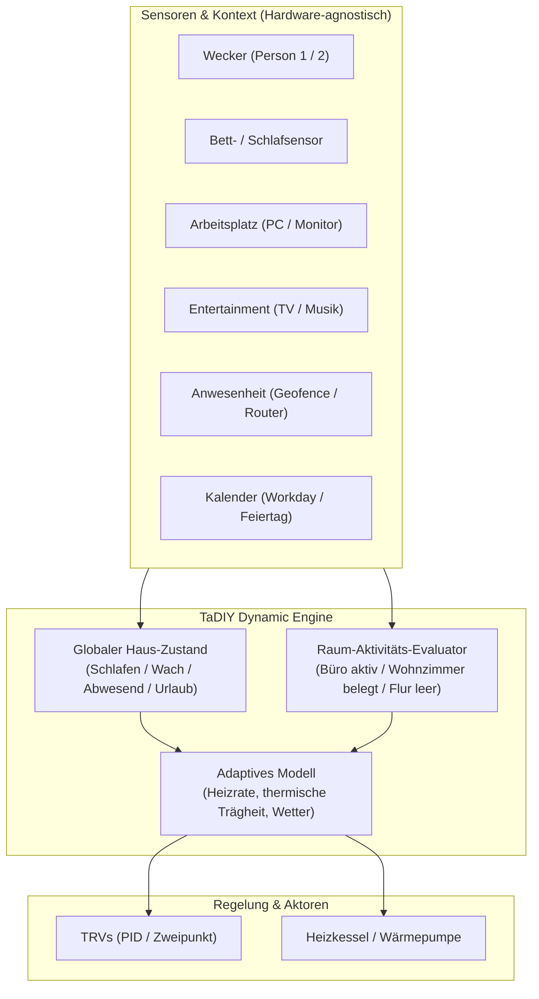

# TaDIY Dynamic Heating Masterplan: Autonomous „Run & Forget“

> **Ziel:** Ein intelligentes, selbsteinstellendes Heizsystem, das sich nahtlos an den echten Lebensrhythmus aller Bewohner anpasst – ohne starre Zeitpläne, ohne App-Zwang für Mitbewohner und ohne wiederkehrenden Wartungsaufwand.

---

## 1. Kernphilosophie: Kontext statt Zeitplan

Traditionelle Smart-Home-Thermostate scheitern an unregelmäßigen Arbeitszeiten, Schichtdienst, spontanem Homeoffice, Überstunden oder Wochenenden im Bett.  
Der Modus **Dynamisch** ersetzt fixe Uhrzeiten durch eine **mehrstufige Zustandserkennung**:

---

## 2. Die 6 Lebensszenarien & Sensor-Archetypen

| Szenario | Auslöser / Primärsensor | Fallback (ohne Sensor) | TaDIY Reaktion |
| :--- | :--- | :--- | :--- |
| **1. Aufwachphase** | Frühester aktiver Wecker (`sensor.*_next_alarm`) | Fester Basis-Startzeitplan | Berechnet dynamischen Vorheizstart pro Raum (Bad/Küche warm beim Aufstehen). |
| **2. Nachtruhe** | Schlafsensor (Bettmatte / Withings) ODER „Alle Handys laden & TV aus nach 22h“ | Zeitblock Nacht (z. B. 23:00) | Sofortige Absenkung im Wohnbereich; Schlafzimmer auf Ziel-Schlaftemperatur. |
| **3. Homeoffice (ad-hoc)** | Arbeitsplatz aktiv (PC-Stromsensor, HA Workstation Switch) | Kalender „Homeoffice“ | Heißt nur das Büro auf Komforttemperatur; restliche Räume bleiben abgesenkt. |
| **4. Feierabend / TV** | TV / Receiver / Mediaplayer `playing` / `on` | Fester Abend-Zeitplan | Hält Wohnzimmer auf Komfort; verhindert vorzeitiges Abkühlen bei langen Filmabenden. |
| **5. Feiertag / Urlaub zu Hause** | HA `binary_sensor.workday_sensor` ist `off` an Wochentag | Manueller Schalter „Freier Tag“ | Behandelt Werktag automatisch wie Wochenende (kein frühes Büro-Vorheizen). |
| **6. Außer Haus / Urlaub** | `person.*` alle `not_home` (optional Geofence / Router-WLAN) | Manuelle Abwesenheit | Hausweite Absenkung auf `away_temperature`; bei Annäherung Vorheizung. |

---

## 3. Raum-Ebene: Dynamisches Bedarfsheizen (Micro-Zoning)

Nicht jeder Raum muss dauerhaft geheizt werden. Jeder Raum erhält im Modus **Dynamisch**:

1. **Aktivitäts-Entitäten**:
   * Liste beliebiger Entitäten (`switch`, `binary_sensor`, `media_player`, `sensor`).
   * Ist mindestens eine Entität aktiv -> Raumzustand = **Aktiv** (Komfort-Solltemperatur).
2. **Nachlaufzeit (Inaktivitäts-Timeout)**:
   * Wenn Aktivität endet (z. B. PC aus): Raum bleibt noch $X$ Minuten (Standard: 30 Min.) auf Temperatur, bevor er auf Absenktemperatur fällt (verhindert Takten bei kurzen Pausen).
3. **Vorrang von Fenster- & Feuchtigkeitsschutz**:
   * Fensteröffnung überschreibt sofort die Aktivitätsheizung.
   * Schimmel- / Feuchtigkeitsschutz (Taupunktüberwachung) sichert Mindesttemperatur.

---

## 4. Run & Forget Failsafes (Ausfallsicherheit)

* **Sensor-Timeout / Offline-Guard**:
  Wenn ein Schlafsensor oder Wecker keine gültigen Daten liefert (z. B. Smartphone-Akku leer), greift automatisch der hinterlegte Basis-Zeitplan als Sicherheitsnetz.
* **Kein App-Zwang**:
  Familienmitglieder und Gäste müssen keine App installieren. Das System reagiert auf die vorhandenen Hausgeräte (TV, PC, Bett, Beleuchtungsstrom).
* **Sanfte Übergänge**:
  Sollwertanpassungen erfolgen stufenweise (gedämpft über die thermische Raum-Trägheit), um TRV-Fahrgeräusche zu minimieren.

---

## 5. Implementierungs-Roadmap & Checklist

### Phase 1: Hub Foundation (Modus `dynamic` & Globale Sensoren)
- [ ] Neuer Hub-Modus `dynamic` im Select-Menü und Backend
- [ ] Hub-Konfiguration: Multi-Entity-Picker für **Wecker-Sensoren** (`sensor.*_next_alarm`)
- [ ] Hub-Konfiguration: Multi-Entity-Picker für **Bett- / Schlafsensoren** (`binary_sensor.*`)
- [ ] Dynamische Auswertung: Frühester Wecker bestimmt Vorheizbeginn für den Morgen

### Phase 2: Raum-Aktivitätsengine
- [ ] Raum-Konfiguration: Multi-Entity-Picker für **Aktivitäts-Sensoren** pro Raum (PC, TV, Präsenz)
- [ ] Raum-Konfiguration: Konfigurierbare Nachlaufzeit (Timeout nach Inaktivität in Minuten)
- [ ] Automatische Umschaltung: Aktiv -> Komfort-Sollwert; Inaktiv -> Eco-/Absenkwert

### Phase 3: Feiertags- & Urlaub-zu-Hause-Erkennung
- [ ] Hub-Konfiguration: Verknüpfung mit Home Assistant Workday-Sensor (`binary_sensor.workday`)
- [ ] Automatisches Ausführen des Wochenend-Zeitplans an Feiertagen und freien Tagen

### Phase 4: Validierung & Tests
- [ ] Failsafe-Tests: Verhalten bei leerem / getrenntem Wecker-Sensor
- [ ] Live-Diagnose im TaDIY-Panel: Anzeige des aktuellen dynamischen Zustands (Aktivitätsgrund, nächster Wecker, Schlaferkennung)
